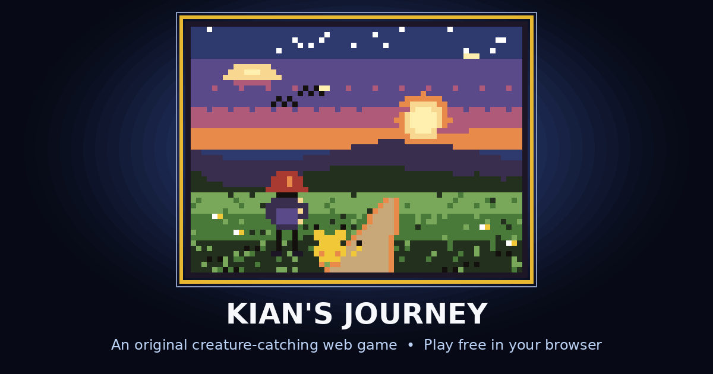

# Kian's Journey

**An original creature-catching web game by Naman Parmar.**

Journey with Kian and his partner **Voltik** across a hand-built pixel-art world — catch and train Kin, challenge gym leaders, and walk one long road through four regions, the Amber Isles, and the Trial Grounds. Everything in the game — code, creatures, story, music, and artwork — was created for this project.

[](https://nx9161.github.io/ashs-journey/)

## ▶ Play now

**[Play Kian's Journey in your browser →](https://nx9161.github.io/ashs-journey/)**

Free to play. No account, no downloads, no ads, and no in-game purchases. The game runs entirely in your browser and works offline once loaded; your progress saves on your device.

## Features

- **A full-length adventure** — 64 towns across the regions of Arden, Yamato, Maris, and Borea, plus the Amber Isles and the Trial Grounds endgame
- **493 original Kin** to discover, catch, train, and evolve — every species designed, named, and drawn for this game
- **36 gyms** and each region's own endgame, from Leagues and Conferences to the Trial Grounds' seven Frontier Brains
- **An original story** in 11 arcs and 212 chapters, written for this world and its cast
- **Original art and music** — hand-authored pixel art throughout and a fully original chiptune score and sound set
- **Built for phone and desktop** — touch controls on mobile, full keyboard play on desktop, and an in-game options menu (text speed, battle style, difficulty, control remapping, and more)
- **Private by design** — no analytics, no tracking, and no network calls in the playable build

## Controls

| Action | Keyboard |
| --- | --- |
| Move | Arrow keys or WASD |
| Confirm / talk (A) | Z or Space |
| Cancel / back (B) | X or Backspace |
| Menu (Start) | Enter |
| Page through lists | Q / E or Page Up / Page Down |
| Select | Shift |
| Mute | M |
| Fullscreen | F |

Touch controls appear automatically on touch devices. Controls can be remapped in **Options → Controls**.

## About the project

Kian's Journey is a single-author project built with vanilla JavaScript, the Canvas 2D API, and WebAudio — no game engine and no runtime dependencies in the playable build. The world, its 432 maps, and every system (battles, quests, evolution, contests, ferries, and the Trial Grounds) are implemented in this repository.

> *Kian's Journey* — © 2026 Naman Parmar. All rights reserved.
>
> Kian's Journey is an original work by Naman Parmar. Its creatures, names, characters, story, music, and original artwork were created by Naman Parmar for this game. This is a free, non-commercial work. No purchase is required or accepted.

## Development

Requires Node.js only — the game build has **zero npm dependencies**.

```sh
node scripts/build.mjs            # emits dist/standalone.html + personal/
node scripts/verify-slice.mjs     # headless playthrough: boot → catch → badge → save
node tests/run-checks.mjs         # full check fleet
```

| Path | Contents |
| --- | --- |
| `src/engine/` | Fixed-timestep loop, input, renderer, WebAudio chiptune engine, formulas, RNG |
| `src/game/` | Scenes — title, intro, overworld, battle, menus — plus state and UI |
| `src/data/` | Species, moves, items, maps, and dialogue (all original content) |
| `src/save/` | Versioned save schema and the local-storage guest store |
| `assets/` | Asset provenance manifest, sprites, and fonts |
| `scripts/` | Build, budget / contamination / drift gates, and audits |
| `dist/` | The guest single-file build (offline) — the canonical edition |

Performance and size budgets live in [`budgets.json`](budgets.json); the build fails if a gate is exceeded. Asset contracts are documented in [`docs/contracts.md`](docs/contracts.md).

## Credits

- **Game, story, art, and music** — Naman Parmar
- **World tileset and one character** — Damian Gasinski ("Gassasin"), used under CC-BY 3.0 and credited in the game's Legal screen
- **Fonts** — Galmuri by Lee Minseo (quiple) and Pixelify Sans by the Pixelify Sans Project Authors, both under the SIL Open Font License 1.1

Full attributions are in [`THIRD-PARTY-NOTICES.md`](THIRD-PARTY-NOTICES.md) and in the game's Legal screen.

---

Built by **Naman Parmar** ([@nx9161](https://github.com/nx9161)).
